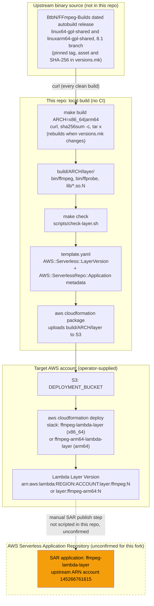
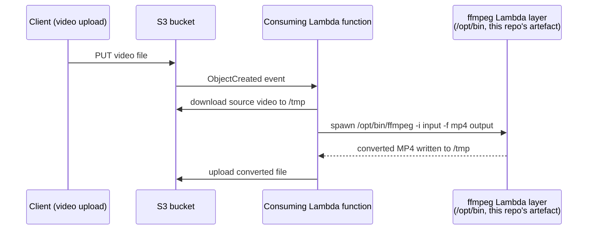

# Architecture

This document describes how the FFmpeg Lambda layer in this repository is **built, packaged, published,
and consumed** — there is no request-processing runtime of its own to diagram, since the repo's only output
is a Lambda layer version (a `.zip` of glibc-linked FFmpeg binaries and their shared libraries plus CloudFormation/SAR metadata), not a service.

See [CLAUDE.md](../CLAUDE.md) for the full project overview, conventions, and open questions
(in particular the [upstream-vs-fork identity question](../CLAUDE.md#upstream-vs-fork-identity-open-question)
referenced throughout this document).

## Why there is no `failure-scenarios.md`

Some projects pair `architecture.md` with a `failure-scenarios.md`
documenting SQS/SNS retry semantics, DLQ behaviour, and partial-batch failure handling. **That document
doesn't apply here.** This repo has no message queue, no event source mapping, and no runtime request path
of its own — it is a build/publish artefact. There is nothing that "retries" or "redelivers." The failure
modes that actually matter for a repo like this are **build-time** and **publish-time**, not
request-time, so they are covered briefly below instead of in a separate document.

## Build, Package, and Publish Flow

Notes on the diagram:

- The dashed edge into the SAR box reflects that **publishing a new SAR application version is a manual
  step outside this repo's `Makefile`** — `make deploy` only produces a private CloudFormation stack with a
  layer version in whatever account/region the operator targets. Whether this fork has ever actually been
  re-published as its own SAR application (as opposed to consumers using the upstream project's SAR
  listing, account `145266761615`) is unconfirmed — see
  [CLAUDE.md's open question](../CLAUDE.md#upstream-vs-fork-identity-open-question).
- The FFmpeg binary source is a **pinned, dated BtbN release** for each architecture. `versions.mk` holds
  the release tag, the asset names and the SHA-256 of each, and the `Makefile` stops before extracting if a
  download does not match. Two builds on different days package the same binaries.
- `make check` first fails if the layer is over 240,000,000 bytes unzipped, contains a symlink, or has a
  library `ldd` cannot resolve; it then converts an irregular-timestamp WebM to MP4 with the bundled `ffmpeg` and fails if the output
  does not hold 95-100% of the input frames (FFmpeg 7.0.2 and older duplicate them; 7.1 and later do not). Evidence: 4.4.1, 6.1.1 and 7.0.2 were tested and duplicate frames for variable-frame-rate WebM (1 ms time base, no declared frame rate) converted to MP4 without a frame-rate option, while 7.1, 7.1.1, 8.0 and 8.0.1 keep the input frames (matching the upstream FFmpeg commit "lavf/movenc: mark mov/mp4 as supporting VFR"), and this repo's own check (7.0.2: 10390 frames from 300; 8.1.3: 300).
- **To bump FFmpeg**, edit `versions.mk` (a newer autobuild on a release branch, hashes from that release's
  `checksums.sha256`), run `make check` for both architectures, then publish both layers.

## Consumption Flow

A consuming Lambda attaches the layer by its `LayerVersion` ARN and calls `/opt/bin/ffmpeg` and
`/opt/bin/ffprobe`. It does not depend on this repo's source or Git history at all, only on a layer ARN
that already exists in its own AWS account and region.

Layer ARNs are account- and region-specific. Publishing a new layer version from this repo does **not**
update consumers that pin a version by ARN: each consumer must change the version suffix of its own ARN.
See [CLAUDE.md § Ecosystem Position](../CLAUDE.md#ecosystem-position) for more detail.

`example/src/index.js` in this repo demonstrates the same `/opt/bin/ffmpeg` invocation pattern
(thumbnail extraction rather than transcoding) against the example stack's own layer reference — see
[CLAUDE.md § The `example/` directory](../CLAUDE.md#the-example-directory).

## Build/Publish Failure Modes

Since there is no runtime request path, "failure scenarios" for this repo are about the build and publish
steps going wrong, not about message redelivery or retries:

| Failure mode | Cause | Effect | Mitigation in this repo |
|---|---|---|---|
| Changed download | The BtbN asset for the pinned tag differs from the hash in `versions.mk` (or is deleted: BtbN removes old autobuilds) | `make build` stops at `sha256sum -c` before extracting; nothing reaches AWS | The hash check detects any change to the asset after pinning; the pinned hashes were cross-checked against BtbN's published `checksums.sha256` at pin time. It does not prove BtbN's own build is trustworthy. If the release has been removed, bump `versions.mk` to a current release (see above) |
| Upstream URL unavailability | `curl` to `github.com` fails (network issue) | `make deploy` fails at the `build/ARCH/layer/bin/ffmpeg` step before anything reaches AWS; no partial layer is deployed, since moving `bin/` into the layer is the last step | A failed `curl` or hash check leaves no `build/ARCH/layer/bin/ffmpeg`, so the next run retries cleanly |
| Limited automated tests, no CI | `make check` covers layer size, library resolution and the frame-count behaviour only; no `.github/workflows/` | A change to `template.yaml` (e.g. a bad `ContentUri`) is only caught by a human running `make deploy` against a real AWS account, or by the consuming Lambda failing at cold start (`ENOENT: /opt/bin/ffmpeg`) | `make check` for the binaries; none for the template. Any CI addition should be scoped deliberately |
| Runtime and glibc compatibility | `template.yaml` declares `nodejs24.x`, `nodejs22.x`, `python3.13`; the BtbN binaries need glibc 2.28 or later | The layer works on Amazon Linux 2023 runtimes and fails with a glibc error on Amazon Linux 2 runtimes | Declared runtimes are Amazon Linux 2023 only |
| Cross-account ARN drift | A layer version deployed via `make deploy` is account/region-specific (`arn:aws:lambda:REGION:ACCOUNT:layer:ffmpeg:N`) | If this repo is redeployed into a *different* account than a consumer expects (e.g. a new environment), the consumer's hard-coded ARN will not resolve — there is no cross-account/cross-region layer sharing configured anywhere in this repo's `template.yaml` | None — `AWS::Serverless::LayerVersion` here has no `LayerPermission`/cross-account grant resource; if cross-account sharing is ever needed, that is new work, not an existing capability |

## Open Questions

> **TODO(owner):** Decide whether to publish this fork as its own AWS Serverless Application Repository
> listing (with its own account-scoped ARN and `SemanticVersion` lineage), or to keep deploying it only as
> a private stack with `make deploy`, bypassing SAR entirely — see
> [CLAUDE.md](../CLAUDE.md#upstream-vs-fork-identity-open-question).
